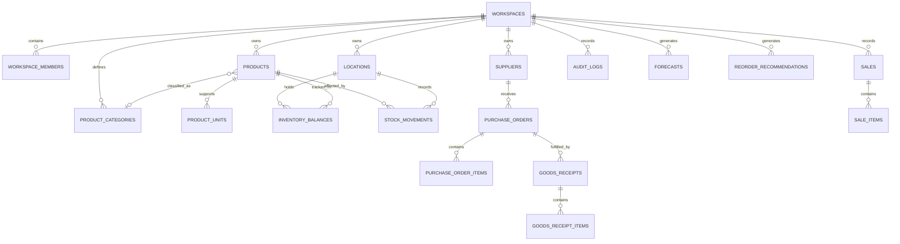

# Ziggy — Database Schema Specification

**Document:** 03 — Database Schema  
**Version:** 1.1

**Database:** Neon PostgreSQL  
**Status:** Corrected MVP schema — **proposed; no tables exist yet** — plus deferred reference tables

> **Scope correction.** Ziggy is an Online Inventory and Stock Management System (see PRD v1.1). The consumer-storefront tables once proposed here (`customers`, `customer_addresses`, `customer_orders`, `customer_order_items`) are **superseded and must not be created**. Sections marked *deferred* are advanced reference material, not prerequisites for the college prototype.

## MVP data model (authoritative for the prototype)

Created through Drizzle migrations only. Conventions in §1 apply (UUID keys, `snake_case`, `timestamptz`, `numeric` quantities). One seeded workspace and one seeded location; every table still carries `workspace_id` (and `location_id` where stock is held).

| Table | Owner (see `TEAM_HANDOFF.md` §7) | Key columns and rules |
|---|---|---|
| `users` | Identity | `id`, `clerk_user_id` (unique), `email`, `display_name`. Created on first sign-in with **no membership**. |
| `workspaces` | Identity | `id`, `name`, `slug`, `settings` (JSONB; holds `defaultLowStockThreshold`). One seeded row. |
| `workspace_members` | Identity | PK `(workspace_id, user_id)`, `role` ∈ `USER`/`STAFF`/`ADMIN`, `status` ∈ `ACTIVE`/`SUSPENDED`. Created only by the seed script or by an Admin — never automatically on sign-up. |
| `locations` | Identity | One seeded row ("Main store"). Same shape as §4. |
| `audit_logs` | Identity | `workspace_id`, `actor_user_id`, `action`, `entity_type`, `entity_id`, `created_at`, minimal `context`. |
| `product_categories` | Catalogue | `name` unique per workspace; cannot be deleted while products reference it. |
| `suppliers` | Catalogue | As §6. Deleted only if no movement references it; otherwise `is_active = false`. |
| `products` | Catalogue | `sku` unique per workspace, `name`, `description`, `category_id`, `unit_label` (e.g. `pcs`, `kg`, `box`), `low_stock_threshold` (nullable numeric ≥ 0; null = workspace default), `is_active`. **No quantity column.** |
| `inventory_balances` | Inventory | PK `(location_id, product_id)`, `workspace_id`, `quantity_on_hand numeric(20,6)` with `CHECK (quantity_on_hand >= 0)`, `updated_at`. Row created when the product is created (or at first movement). |
| `stock_movements` | Inventory | See below. Immutable. |
| `idempotency_keys` | Inventory | `workspace_id`, `user_id`, `key`, `operation`, `request_hash`, `movement_id`, `response_body`, `created_at`; unique `(workspace_id, key)`. Retention is a policy decision (suggest 24 h cleanup). |

### `stock_movements`

| Column | Type | Rules |
|---|---|---|
| `id` | UUID | Primary key |
| `workspace_id` | UUID | Required; composite FKs prevent cross-workspace references |
| `location_id` | UUID | Required |
| `product_id` | UUID | Required |
| `movement_type` | TEXT | `STOCK_IN` or `STOCK_OUT` |
| `reason_code` | TEXT | See list below |
| `quantity` | NUMERIC(20,6) | Always `> 0`; direction comes from `movement_type` |
| `balance_after` | NUMERIC(20,6) | Quantity on hand immediately after this movement (snapshot for history) |
| `supplier_id` | UUID | Optional; normally set for `PURCHASE` |
| `unit_cost` | NUMERIC(20,6) | Optional, `>= 0`; informational only (no valuation in MVP) |
| `reference` | TEXT | Optional invoice / issue-slip / lab-request number |
| `note` | TEXT | Optional free text |
| `reverses_movement_id` | UUID | Set only on reversal movements (stretch goal) |
| `idempotency_key` | TEXT | Key supplied by the client for the posting request |
| `created_by` | UUID | Actor, FK to `users`; set by the server |
| `occurred_at` | TIMESTAMPTZ | Business time; defaults to `created_at` |
| `created_at` | TIMESTAMPTZ | Server time |

Reason codes — stock in: `PURCHASE`, `OPENING_STOCK`, `RETURN_IN`, `ADJUSTMENT_IN`. Stock out: `ISSUE` (generic stock leaving inventory), `USED`, `DAMAGED`, `LOST`, `ADJUSTMENT_OUT`. `REVERSAL` is used by compensating movements. "Issue" means stock leaving inventory, not a complaint.

Rules:

- Rows are never updated or deleted (enforce with application code and, ideally, a database trigger or revoked privileges).
- A product that has any `stock_movements` row cannot be deleted; set `is_active = false`.
- Posting (one transaction): resolve idempotency key → lock the `inventory_balances` row (`SELECT … FOR UPDATE`, or a conditional `UPDATE … WHERE quantity_on_hand >= :qty RETURNING`) → verify availability for `STOCK_OUT` → insert the movement with `balance_after` → update the balance → write an audit row → commit. Any failure rolls back everything.
- Indexes (suggested): `(workspace_id, product_id, created_at desc)`, `(workspace_id, created_at desc)`, `(workspace_id, movement_type, created_at desc)`.

### Low-stock rule

Computed on read, not stored: for an active product, `quantity_on_hand <= COALESCE(products.low_stock_threshold, workspace default)`. Status labels: **Out of stock** (`quantity = 0`), **Low stock** (above 0 but at/below threshold), **In stock** (above threshold). If a persisted `alerts` table is ever added it must be derived from this same rule.

## 1. Database Design Principles

The database must:

- Support multiple businesses and multiple locations per business.
- Prevent users from accessing another workspace's data.
- Preserve a traceable history of inventory transactions.
- Maintain accurate quantities. *(Inventory valuation is deferred.)*
- *(Deferred)* Support partial purchase receipts.
- *(Deferred)* Support product-specific unit conversions.
- Provide reliable reporting. *(AI analytics is deferred.)*
- Enforce integrity through database constraints and transactions.

### Naming conventions

- Table and column names use `snake_case`.
- Primary keys use UUIDs.
- Timestamps are stored as `timestamptz` in UTC.
- Monetary values and unit costs use `numeric`, never floating-point types.
- Quantities use `numeric` to support fractional units.
- Business-owned records include `workspace_id` wherever appropriate.
- Posted inventory transactions are not silently overwritten.

## 2. Entity Relationship Overview

> Full conceptual model. Only the tables in the *MVP data model* section are required for the prototype; purchasing, sales, `product_units`, valuation, forecast, and recommendation tables are **deferred reference**.

The diagram is conceptual. Production migrations must include all foreign keys, composite constraints, and transaction-source relationships described below.

## 3. Workspace and User Tables

### 3.1 `workspaces`

Represents a business account.

| Column | Type | Rules |
|---|---|---|
| `id` | UUID | Primary key |
| `name` | TEXT | Required |
| `slug` | TEXT | Unique |
| `default_currency` | CHAR(3) | Default `INR` |
| `timezone` | TEXT | Required |
| `settings` | JSONB | Default empty object |
| `created_at` | TIMESTAMPTZ | Required |
| `updated_at` | TIMESTAMPTZ | Required |

The workspace's default currency is configurable. Currency changes must not silently reinterpret historical financial values.

### 3.2 `users`

Stores the application's internal user profile linked to Clerk.

| Column | Type | Rules |
|---|---|---|
| `id` | UUID | Primary key |
| `clerk_user_id` | TEXT | Unique, required |
| `display_name` | TEXT | Optional |
| `email` | TEXT | Optional |
| `created_at` | TIMESTAMPTZ | Required |
| `updated_at` | TIMESTAMPTZ | Required |

Clerk remains the authentication provider. Passwords and authentication secrets must not be stored in this table.

### 3.3 `workspace_members`

Associates users with businesses.

| Column | Type | Rules |
|---|---|---|
| `workspace_id` | UUID | FK to workspaces |
| `user_id` | UUID | FK to users |
| `role` | TEXT | `USER`, `STAFF`, or `ADMIN` (nested; `USER` is read-only) |
| `status` | TEXT | `ACTIVE` or `SUSPENDED` |
| `created_at` | TIMESTAMPTZ | Required |

**Primary key:** `(workspace_id, user_id)`

A user can belong to multiple workspaces, with a separate role in each. Membership status must be checked before access is granted.

## 4. Locations

> MVP: exactly one seeded row. Multi-location behavior is a future extension.

### `locations`

Represents a branch or warehouse.

| Column | Type | Rules |
|---|---|---|
| `id` | UUID | Primary key |
| `workspace_id` | UUID | FK to workspaces |
| `name` | TEXT | Required |
| `code` | TEXT | Required within workspace |
| `location_type` | TEXT | `BRANCH` or `WAREHOUSE` |
| `address` | JSONB | Optional |
| `is_active` | BOOLEAN | Default true |
| `created_at` | TIMESTAMPTZ | Required |
| `updated_at` | TIMESTAMPTZ | Required |

Constraints:

- Unique `(workspace_id, code)`.
- Foreign keys must prevent cross-workspace references.
- Referenced locations should be deactivated rather than deleted when historical transactions exist.

## 5. Product Catalogue

### 5.1 `product_categories`

| Column | Type | Rules |
|---|---|---|
| `id` | UUID | Primary key |
| `workspace_id` | UUID | FK to workspaces |
| `name` | TEXT | Required |
| `parent_id` | UUID | Optional self-reference |
| `created_at` | TIMESTAMPTZ | Required |

Unique category names may be enforced within the relevant parent/category scope.

### 5.2 `products`

| Column | Type | Rules |
|---|---|---|
| `id` | UUID | Primary key |
| `workspace_id` | UUID | FK to workspaces |
| `category_id` | UUID | Optional FK |
| `sku` | TEXT | Required within workspace |
| `name` | TEXT | Required |
| `description` | TEXT | Optional |
| `base_unit_code` | TEXT | Required *(MVP: use `unit_label` and `low_stock_threshold` from the MVP data model instead of unit conversions)* |
| `barcode` | TEXT | Optional |
| `image_object_key` | TEXT | Optional *(deferred)* |
| `is_active` | BOOLEAN | Default true |
| `created_at` | TIMESTAMPTZ | Required |
| `updated_at` | TIMESTAMPTZ | Required |

Constraints:

- Unique `(workspace_id, sku)`.
- If barcode uniqueness is required, enforce it within the workspace.
- Product references must remain valid for historical transactions.
- Product images are stored in object storage; the database holds the object key.

The base unit defines how inventory quantities are stored. For example, a product sold in bags may use `kg` as its base stock unit, with a conversion of one bag to 25 kg.

### 5.3 `product_units` *(deferred — not in the MVP; MVP uses `products.unit_label`)*

Stores supported units and conversions for each product.

| Column | Type | Rules |
|---|---|---|
| `id` | UUID | Primary key |
| `workspace_id` | UUID | Required |
| `product_id` | UUID | FK to products |
| `unit_code` | TEXT | Required |
| `conversion_to_base` | NUMERIC(20,8) | Greater than zero |
| `is_base_unit` | BOOLEAN | Default false |

Constraints:

- Unique `(product_id, unit_code)`.
- Exactly one base unit per product.
- The base unit conversion equals 1.
- Conversion definitions used by posted transactions must not be changed retroactively.

If a business changes packaging or a conversion factor, create a controlled version or new unit definition so historical quantities remain interpretable.

## 6. Suppliers

### `suppliers`

| Column | Type | Rules |
|---|---|---|
| `id` | UUID | Primary key |
| `workspace_id` | UUID | FK to workspaces |
| `name` | TEXT | Required |
| `contact_name` | TEXT | Optional |
| `email` | TEXT | Optional |
| `phone` | TEXT | Optional |
| `address` | JSONB | Optional |
| `notes` | TEXT | Optional |
| `is_active` | BOOLEAN | Default true |
| `created_at` | TIMESTAMPTZ | Required |
| `updated_at` | TIMESTAMPTZ | Required |

Supplier details are workspace-specific. The same supplier may be entered separately by different businesses.

## 7. Purchasing Tables *(deferred — not in the MVP)*

> Purchase orders and goods receipts are future enhancements. In the MVP a purchase is recorded directly as a `STOCK_IN` movement with `reason_code = PURCHASE` and an optional supplier. This section is truncated in its source and kept as reference only.

### 7.1 `purchase_orders`

Represents a procurement order.

| Column | Type | Rules |
|---|---|---|
| `id` | UUID | Primary key |
| `workspace_id` | UUID | Required |
| `supplier_id` | UUID | Required |
| `destination_location_id` | UUID | Required |
| `order_number` | TEXT | Unique within workspace |
| `status` | TEXT | See statuses below |
| `ordered_at` | TIMESTAMPTZ | Required |
| `expected_at` | TIMESTAMPTZ | Optional |
| `currency_code` | CHAR(3) | Required |
| `notes` | TEXT | Optional |
| `created_by` | UUID | FK to users |
| `created_at` | TIMESTAMPTZ | Required |
| `updated_at` | TIMESTAMPTZ | Required |

Suggested statuses:

- `DRAFT`
- `SUBMITTED`
- `PARTIALLY_RECEIVED`
- `RECEIVED`
- `CANCELLED`

The valid state transitions must be enforced by application logic.

### 7.2 `purchase_order_items`

| Column | Type | Rules |
|---|---|---|
| `id` | UUID | Primary key |
| `workspace_id` | UUID | Required |
| `purchase_order_id` | UUID | Required |
| `product_id` | UUID | Required |
| `ordered_quantity` | NUMERIC(20,6) | Greater than zero |
| `unit_code` | TEXT | Required |
| `conversion_to_base_snapshot` | NUMERIC(20,8) | Greater than zero |
| `unit_cost` | NUMERIC(20,6) | Non-negative |
| `created_at` | TIMESTAMPTZ | Required |

Store the conversion factor used when the order was created so subsequent unit-definition changes do not alter historical order quantities.

### 7.3 `goods_receipts`

Represents a physical receipt against a purchase order.

| Column | Type | Rules |
|---|---|---|
| `id` | UUID | Primary key |
| `workspace_id` | UUID | Required |
| `purchase_order_id` | UUID | Required |
| `receipt_number` | TEXT | Unique within workspace |
| `status` | TEXT | `DRAFT`, `POSTED`, `REVERSED` |
| `received_at` | TIMESTAMPTZ | Required |
| `posted_at` | TIMESTAMPTZ | Optional |
| `created_by` | UUID | FK to users |
| `posted_by` | UUID | Optional FK to users |
| `created_at` | TIMESTAMPTZ | Required |

### 7.4 `goods_receipt_items`

| Column | Type | Rules |
|---|---|---|
| `id` | UUID | Primary key |
| `workspace_id` | UUID | Required |
| `goods_receipt_id` | UUID | Required |
| `purchase_order_item_id` | UUID | Required |
| `product_id` | UUID | Required |
| `received_quantity` | NUMERIC(20,6) | Greater than zero |
| `base_quantity` | NUMERIC(20,6) | Greater than zero |
| `unit_cost` | NUMERIC(20,6) | Non-negative |
| `created_at` | TIMESTAMPTZ | Required |

The posting process must validate cumulative accepted receipts against the ordered quantity, unless an explicitly authorized over-receipt policy is introduced.

A posted receipt creates stock movements. Saving a draft receipt does
