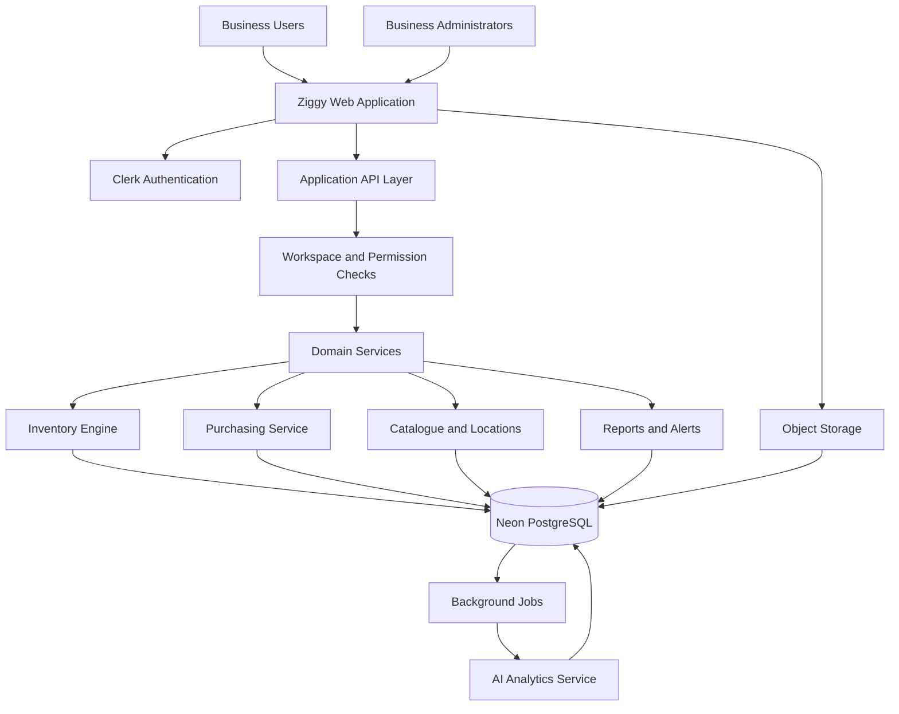

# Ziggy — System Architecture

**Document:** 02 — System Architecture  
**Version:** 1.0  
**Status:** Proposed architecture for MVP

## 1. Architecture Goals

The architecture must:

- Support multiple businesses (workspaces) with strict tenant isolation.
- Manage inventory across multiple branches and warehouses.
- Maintain accurate stock quantities and inventory valuation.
- Support purchase orders, partial receipts, sales, adjustments, and transfers.
- Provide a responsive web interface for desktop, tablet, and mobile.
- Integrate AI-assisted forecasting and replenishment recommendations.
- Keep stock-changing operations transactional and auditable.
- Allow future scaling without introducing unnecessary microservices during the MVP.

## 2. Recommended Technology Stack

| Layer | Technology | Responsibility |
|---|---|---|
| Web application | Next.js + React + TypeScript | User interface, routing, server rendering |
| Styling | Tailwind CSS + shadcn/ui | Responsive, consistent UI |
| Authentication | Clerk | Sign-in, Google OAuth, identity management |
| Application backend | Next.js Route Handlers / server-side services | Business logic and API endpoints |
| Database | Neon PostgreSQL | Persistent relational data |
| Database access | Drizzle ORM or equivalent typed SQL layer | Queries, schema management, migrations |
| Validation | Zod | Request and form validation |
| Image storage | S3-compatible object storage | Product images and uploaded assets |
| Background processing | Managed job runner or queue | Forecast generation and scheduled tasks |
| AI analytics | Separate Python service when needed | Forecasting, anomaly analysis, recommendations |
| Deployment | Next.js-compatible hosting + managed services | Application deployment and operations |
| Monitoring | Structured logs and error monitoring | Reliability and debugging |

**Architecture decision:** Begin with a modular monolith. Keep the core inventory engine inside the main backend rather than splitting every domain into independent services. Extract the AI service or background workers when scale or operational needs justify it.

## 3. High-Level Architecture

The diagram represents logical responsibilities. In the MVP, the application API and domain services may run in the same deployed application.

## 4. Application Layers

### 4.1 Presentation Layer

The presentation layer contains the Ziggy web application.

Primary areas:

- Dashboard and business overview
- Product catalogue
- Inventory by location
- Purchase orders and goods receipts
- Sales and stock issues
- Stock transfers and adjustments
- Suppliers
- Reports and alerts
- Ziggy Intelligence
- Workspace and user settings

The interface must not be trusted to enforce permissions or inventory rules. Every sensitive action must be validated on the server.

### 4.2 Authentication and Access Layer

Clerk handles authentication, including Google OAuth.

After authentication, Ziggy resolves the user's workspace membership and role.

Initial roles:

- `ADMIN`: manages workspace settings, members, locations, products, and operational transactions.
- `STAFF`: performs permitted day-to-day inventory operations.

Permissions must be checked server-side for every protected operation.

**Important:** Clerk authentication proves a user's identity; it does not independently establish access to a particular workspace's inventory. Workspace membership must be checked against Ziggy's own database.

### 4.3 Application API Layer

The API layer receives requests, validates inputs, applies authorization, invokes domain services, and returns consistent responses.

Responsibilities:

1. Validate the request schema.
2. Resolve the authenticated user.
3. Verify workspace membership and permissions.
4. Execute the required domain operation.
5. Commit database changes transactionally.
6. Return a structured response.
7. Record relevant audit information.

Do not put complex inventory calculations directly inside UI components or route handlers. Keep them in reusable domain services.

### 4.4 Domain Services

Organize the backend into modules:

- **Workspace Service:** workspace membership, roles, settings.
- **Catalogue Service:** products, categories, units, suppliers.
- **Location Service:** branches and warehouses.
- **Purchasing Service:** purchase orders and receipts.
- **Inventory Service:** stock movements, availability, transfers, adjustments.
- **Valuation Service:** moving weighted-average cost.
- **Reporting Service:** stock summaries and operational reports.
- **Alert Service:** low-stock and stock-out risk alerts.
- **Intelligence Service:** forecasts and reorder recommendations.
- **Audit Service:** records significant user and system actions.

These modules can share a codebase while maintaining clear boundaries.

## 5. Database Architecture

Neon PostgreSQL is the source of truth for all operational data.

### Core entities

- `users`
- `workspaces`
- `workspace_members`
- `locations`
- `products`
- `product_categories`
- `product_units`
- `suppliers`
- `purchase_orders`
- `purchase_order_items`
- `goods_receipts`
- `goods_receipt_items`
- `sales`
- `sale_items`
- `stock_movements`
- `inventory_balances`
- `inventory_valuations`
- `audit_logs`
- `forecasts`
- `reorder_recommendations`

The complete relational structure, keys, indexes, and constraints are specified in Document 03.

### Tenant isolation

Every business-owned record must be associated with a workspace, directly or through a verified parent relationship.

For every request:

- Resolve the active workspace.
- Confirm membership
