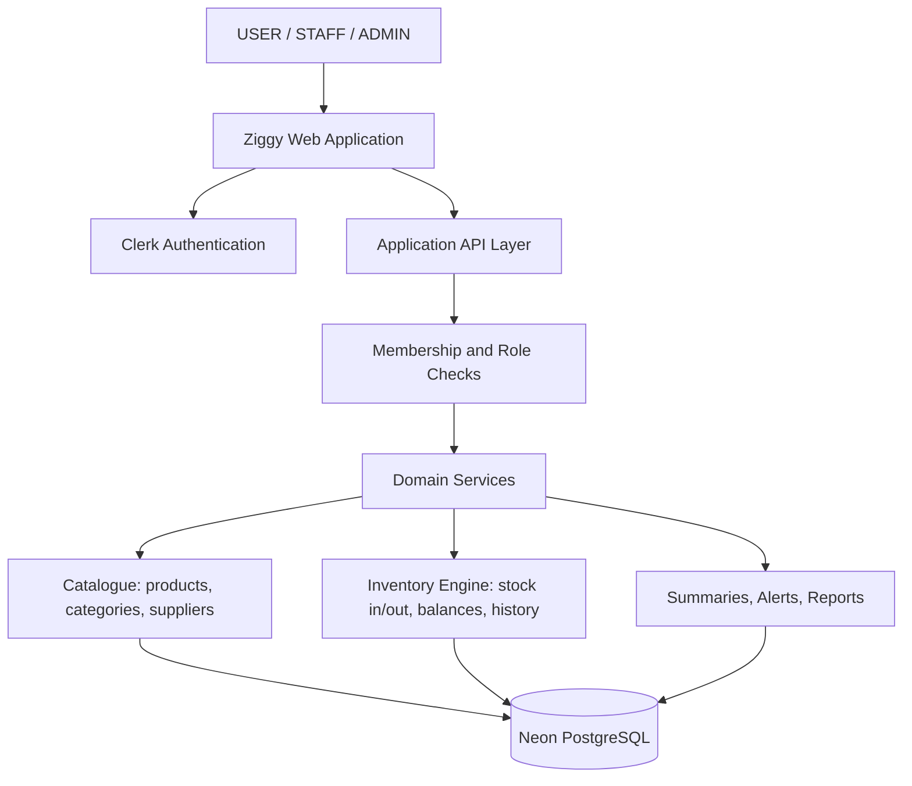

# Ziggy — System Architecture

**Document:** 02 — System Architecture  
**Version:** 1.0  
**Status:** Corrected MVP architecture (proposed; mostly not yet implemented)

## 1. Architecture Goals

> **Scope correction.** Ziggy is an Online Inventory and Stock Management System for small businesses, college laboratories, and campus stores (PRD v1.1). There is no consumer storefront. Sections or items marked *deferred* are future enhancements and reference material only. Nothing described here is implemented yet except the Next.js scaffold, wireframes, and Drizzle/Neon client (see `TEAM_HANDOFF.md` §11).

The architecture must:

- Keep tenant isolation correct (`workspace_id` on business data) even though the prototype runs one seeded workspace and one seeded location.
- Maintain accurate stock quantities through immutable stock movements and server-calculated balances.
- Serve three role-based views (USER, STAFF, ADMIN) from one application, one database, and one set of inventory services.
- Provide a responsive web interface for desktop, tablet, and mobile.
- Keep stock-changing operations transactional, idempotent, and auditable.
- Avoid unnecessary microservices.
- *(Deferred)* Support purchase orders, partial receipts, multiple locations, transfers, weighted-average valuation, and AI forecasting.

## 2. Recommended Technology Stack

| Layer | Technology | Responsibility |
|---|---|---|
| Web application | Next.js + React + TypeScript | User interface, routing, server rendering |
| Styling | Tailwind CSS (installed) + shadcn/ui (planned, not installed) | Responsive, consistent UI |
| Authentication | Clerk (planned, not installed) | Sign-in, Google OAuth, identity management |
| Application backend | Next.js Route Handlers / server-side services | Business logic and API endpoints |
| Database | Neon PostgreSQL | Persistent relational data |
| Database access | Drizzle ORM (installed) | Queries, schema management, migrations |
| Validation | Zod (planned, not installed) | Request and form validation |
| Image storage | *Deferred* — S3-compatible object storage | Product images (not in MVP) |
| Background processing | *Deferred* | Scheduled tasks (not needed for MVP; alerts are computed on read) |
| AI analytics | *Deferred* — separate Python service when justified | Forecasting (see doc 06) |
| Deployment | Next.js-compatible hosting + managed services | Application deployment and operations |
| Monitoring | Structured logs and error monitoring | Reliability and debugging |

**Architecture decision:** Begin with a modular monolith. Keep the core inventory engine inside the main backend rather than splitting every domain into independent services. The three dashboards are role-based views in this one application. Extract workers or an AI service only if a deferred feature later justifies it.

**Dependency status:** installed today — Next.js 16, React 19, Tailwind CSS 4, Drizzle ORM + drizzle-kit, `@neondatabase/serverless`, Lucide, ESLint, TypeScript. Planned, not installed — Clerk, Zod, shadcn/ui, a decimal library (e.g. `decimal.js`), Vitest, Playwright.

## 3. High-Level Architecture

The diagram represents logical responsibilities. The three dashboards are views inside the same web application, not separate deployments. The application API and domain services run in the same deployed Next.js application. Deferred components (purchasing service, valuation, background jobs, object storage, AI service) are intentionally omitted.

## 4. Application Layers

### 4.1 Presentation Layer

One web application with role-based areas sharing a single app shell and design system (route list in `TEAM_HANDOFF.md` §5):

- **USER:** `/inventory` — search/filter products, see stock status. Read-only.
- **STAFF:** `/dashboard`, `/purchasing` (stock in), `/issues` (stock out), `/movements`, `/suppliers` (view).
- **ADMIN:** `/admin`, `/products`, `/categories`, `/suppliers`, `/reports`, `/admin/team`, `/admin/preferences`, `/admin/audit`.
- Public: `/` (inventory entry), `/sign-in`, `/sign-up`, `/access-required`.

The interface must not be trusted to enforce permissions or inventory rules. Every sensitive action must be validated on the server.

### 4.2 Authentication and Access Layer

Clerk handles authentication, including Google OAuth. After authentication, Ziggy resolves the user's `workspace_members` row and role.

Roles (nested): `ADMIN` ⊇ `STAFF` ⊇ `USER`. `USER` is a proposed interpretation of the requested third dashboard. The permissions matrix is in `TEAM_HANDOFF.md` §4 and is the only one.

- A shared helper (`getAccess` / `requireRole(min)`) is called by every protected page and route handler.
- The "Login as" selector only requests a landing route; destination handling is specified in doc 05 §4.4.
- New sign-ups have no membership. Access is granted by seed (first Admin) or by an Admin; never automatically.

**Important:** Clerk authentication proves identity only. Workspace access and role come from Ziggy's own database on every request.

### 4.3 Application API Layer

The API layer receives requests, validates inputs, applies authorization, invokes domain services, and returns consistent responses.

Responsibilities:

1. Validate the request schema.
2. Resolve the authenticated user.
3. Verify membership and the minimum role.
4. Execute the required domain operation.
5. Commit database changes transactionally.
6. Return a structured response.
7. Record relevant audit information.

Do not put inventory calculations in UI components or route handlers. Keep them in reusable domain services.

### 4.4 Domain Services

Organize the backend into modules (a shared codebase with clear boundaries):

- **Access Service:** users, membership, roles, destination handling.
- **Catalogue Service:** products, categories, suppliers.
- **Inventory Service:** `postStockIn`, `postStockOut`, balances, movement history, idempotency, `stockStatus` (the one low-stock rule).
- **Reporting Service:** dashboard summary, low-stock alerts, stock and movement reports, CSV export.
- **Audit Service:** records significant actions.

*Deferred services:* Purchasing (purchase orders and receipts), Location management, Valuation (weighted-average cost), Intelligence (forecasts).

## 5. Database Architecture

Neon PostgreSQL is the source of truth for all operational data. Drizzle ORM manages the schema and migrations.

### Core entities (MVP)

- `users`, `workspaces`, `workspace_members`, `locations`
- `product_categories`, `products`, `suppliers`
- `inventory_balances`, `stock_movements`, `idempotency_keys`
- `audit_logs`

Full columns, constraints, and rules are in Document 03 ("MVP data model"). Deferred entities: `product_units`, `purchase_orders`, `purchase_order_items`, `goods_receipts`, `goods_receipt_items`, `sales`, `sale_items`, `inventory_valuations`, `forecasts`, `reorder_recommendations`.

### Tenant isolation

Every business-owned record must be associated with a workspace, directly or through a verified parent relationship.

For every request:

- Resolve the active workspace.
- Confirm membership
